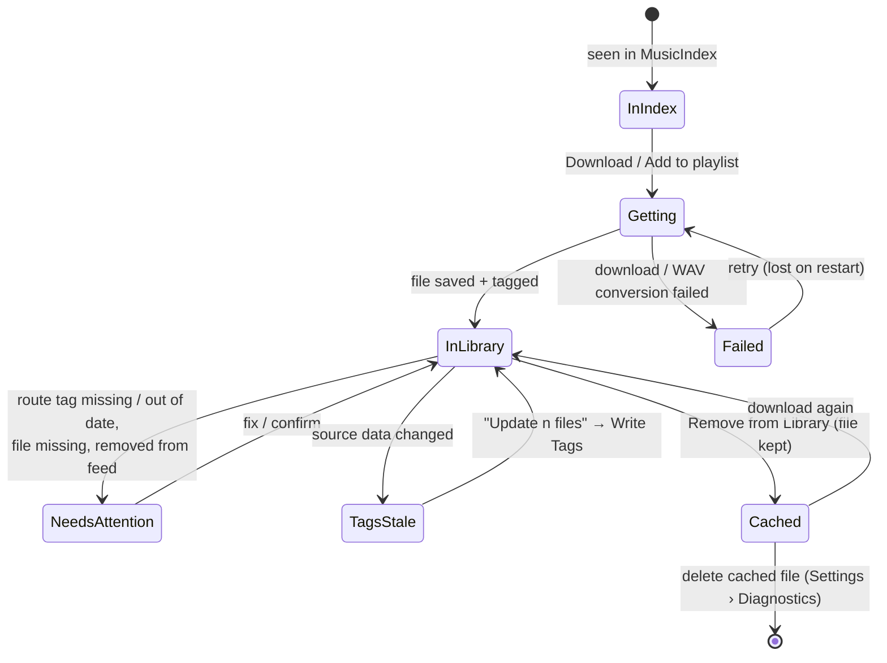

# 01 · What v4vmm can do

Snapshot of `v4vmm` at commit `38ecd9d` (2026-10-24), rediscovered from the code — not from the
app's own docs, which are partly stale. Raw evidence with `file:line` references lives in
[`research/`](research/).

This file describes **capabilities** (what the system can do), not screens. Screens come later.

## Legend

| Mark | Meaning |
|---|---|
| ✅ | Works in the GUI, reasonably reachable |
| 🟡 | In the GUI, but hard to find, inconsistent, or dead-ends somewhere |
| 🤖 | Happens automatically, user never asks for it (and often never sees it) |
| ⌨️ | CLI only |
| 🔧 | Built in code, **no caller** — free to expose |
| 📋 | Planned in the project's docs/ADRs, not built |
| ❌ | Not built, not planned, but a journey seems to need it |

---

## 1. The things a user cares about

| Object | What it is to a user | States the code tracks |
|---|---|---|
| **Release** | An album, EP or single (an RSS music feed) | Not yours · partly yours · yours · has updates |
| **Track** | A song in a release | see lifecycle below |
| **Artist** | Who made a release. Either a confirmed/unverified artist feed, or "just a name" | Artist · Unverified artist · Name only |
| **Playlist** | An ordered set of tracks for a show | Has its own "RSS check" history |
| **Saved search** | A query you re-run | Just a stored query — no "new results" notion |
| **Show session** | The built-in player playing a playlist | Stopped · Playing · Paused |
| **Live event** | A relay event listeners connect to | Created → selected → attached → live/dead |
| **Services** | Publisher, producer (Mixxx), stream encoder (butt) | Active · Inactive · Failed · Not installed · Not reachable |

### Track lifecycle (as the code models it)

> **Observation:** the code tracks ~10 track states, and the UI shows them in different places
> (badges, sidebar buttons, Needs attention, Settings › Cached files). A user really thinks in
> about four: *not mine · getting it · mine (ok / has a problem) · dropped.*

---

## 2. Capabilities by job

### 2.1 Discover

| Capability | Today | Notes |
|---|---|---|
| Browse newest releases from MusicIndex | ✅ | Default landing view. Tiles/list, infinite scroll |
| Search releases / artists / tracks (Index + Library merged, with "in Library" state) | ✅ | Toolbar search. Apostrophes break upstream search |
| Browse all releases / artists A–Z ("Everything" scope) | 🟡 | Hidden behind a scope toggle that resets every launch |
| Artist page: releases grouped by kind and role, "shares albums with" | 🟡 | No page-level "get all", no retry on failure |
| Name-only artist page ("Releases that name X") | ✅ | Capped at 1,000 releases, no load-more |
| Singles of one artist grouped | ✅ | |
| Save a search and re-run it | ✅ | No rename, no "new since last time" ❌ |
| Audition (preview a track before taking it) | 📋 | ADR 0068 Proposed; layout already reserves the slot |
| Browse other curators' playlists (musicL feeds) | 📋 | Deferred |
| Tags / crates | 📋 | Brief mentions, nothing designed |

### 2.2 Collect

| Capability | Today | Notes |
|---|---|---|
| Get a release (download all tracks, tag them, add to Library) | ✅ | Queue: 3 in parallel, 1 per release, progress strip |
| Get one track | 🟡 | Missing on Index track page; dead rows in Tracks list |
| Get many (multi-select → Download n) | ✅ | Selection mode on most lists |
| Get all missing singles of an artist | ✅ | Singles-group page only |
| Add to playlist (auto-downloads if needed) | 🟡 | Those downloads **bypass the queue → no progress**; Index track page can't add |
| WAV→FLAC conversion, retry / redownload / discard | 🟡 | Recovery lives in Settings › Background tools; lost on restart |
| Stop queued downloads | ✅ | In-flight ones can't be cancelled |
| Add a feed by pasting an RSS URL | ❌ | All acquisition starts from MusicIndex |
| Import audio files I already own | ❌ | No folder scan |

### 2.3 Maintain the collection

| Capability | Today | Notes |
|---|---|---|
| Remove from Library (keeps file as "cached") | ✅ | 5 different labels for this verb |
| See / delete cached files | 🟡 | Only in Settings › Diagnostics › Cached files; deletes with **no confirmation** |
| Check all feeds for upstream changes | ✅ | Sidebar button; hidden when sidebar collapsed |
| Apply upstream updates | ✅ | Updates DB only; **does not add newly published tracks** |
| Check one feed when you open its page | 🤖 | Silent network + DB write on page open |
| Detect files whose tags differ from source → "Update n files" → write | ✅ | Scans run automatically after downloads/updates/playback |
| Compare a file's tags vs RSS vs MusicBrainz, stage & apply edits | 🟡 | Library track pages only, behind "Inspect sources" disclosure |
| MusicBrainz lookup (one track / whole album) | 🟡 | Same label for two scopes; results not saved; panel can't be hidden |
| Repair file paths after moving the library | 🤖 / ⌨️ | Automatic at startup; CLI `library repair-paths` |

### 2.4 Readiness (is it safe to use on air?)

| Capability | Today | Notes |
|---|---|---|
| Readiness report per track (route tag missing / no routes upstream / out of date / file missing / not downloaded / removed from feed) | ✅ | "Needs attention" destination + Show Source card + CLI |
| Fix one track's payment route | ✅ | "Fix routes" |
| Fix all tracks' routes at once | ⌨️ | GUI only as a side effect of "Check all feeds" |
| Confirm a track that was removed from its feed | ✅ | Advisory only — playback doesn't enforce it |
| Fix *file missing / route out of date / not downloaded* | ❌ | No fix action offered |
| Playlist RSS check (feeds changed, tracks removed/added, routes) | ✅ | Button + 🤖 automatically when playback starts |
| Mode-aware preflight ("ready to go live?" with named blockers) | 📋 | Curator brief; not designed |

### 2.5 Playlists

| Capability | Today | Notes |
|---|---|---|
| Create / rename / delete (delete confirmed) | 🟡 | Enter doesn't create; 4 different "new playlist" wordings |
| Add tracks/releases (from rows, pages, selection bar, drag, spring-loaded sidebar) | 🟡 | Many paths, several dead ends |
| Reorder (drag, move up/down, move to top/bottom) | ✅ | |
| Remove from playlist / from all playlists | ✅ | Single remove has no confirm (fine) |
| Playlist description | 🔧 | Column exists, never set |
| Import / export playlists | 📋 | Deferred |

### 2.6 Play (built-in player)

| Capability | Today | Notes |
|---|---|---|
| Play a playlist from a row | 🟡 | **Only** from a hovered playlist row; no "play from top" |
| Pause / resume / next / previous | ✅ | Show deck + global shortcuts (which ignore "nothing playing") |
| Auto-advance, skip unplayable | 🤖 | End of last track = "Playback error", session never ends |
| Stop | 🔧 | Command exists, no button (CLI: DB only) |
| Seek / play a single track | 🔧 | |
| Real audio | 🟡 | **Default driver is silent "null"**; mpv must be set in raw config; nothing warns |
| Cue next / reorder from Show | 📋 | ADR 0068 |
| Separate audition output | 📋 | ADR 0068 |

### 2.7 Go live / broadcast

| Capability | Today | Notes |
|---|---|---|
| Create a live event (relay) + token | 🟡 | Only when **no** event exists; afterwards only "Replace" a dead one |
| Pick an existing event | ✅ | Auto-checks on pick |
| Check event live/dead | ✅ | |
| Forget an old event | ⌨️ | CLI only |
| Attach / detach event to publisher target (restarts publisher) | 🟡 | Detach has no confirmation |
| Start / stop / reset publisher & producer services | 🟡 | Stop has no confirmation even while live |
| View service logs | ✅ | Log pane |
| Connect / disconnect stream encoder (butt) | 🟡 | **Puts you on air with no confirmation** |
| Start / stop recording (butt) | 🔧 | Recording state shown, control unwired |
| Copy `<podcast:liveValue>` tag for your RSS feed | 🟡 | Silent clipboard; **known bug: writes bare id, not URL**; user must edit their feed outside the app |
| Live metadata from now-playing (drop file) | 🤖 | Pause clears it |
| Watch what listeners receive, listener count | ✅ | |
| Reserve a durable live event | 📋 | Relay supports it, app doesn't call it |
| Talk breaks / live segments | 📋 | Requested upstream |
| Post-show episode package (recording, song timings, value splits) | 📋 | Requested, no ADR |

### 2.8 Setup, settings, recovery

| Capability | Today | Notes |
|---|---|---|
| Auto-create config, DB, music folder on first run | 🤖 | No onboarding at all |
| Theme, UI scale | ✅ | Applies instantly but lost unless "Save" |
| MusicIndex endpoint | ✅ | "Check" validates syntax only; no connectivity test ❌ |
| Music folder change | 🟡 | Requires raw config editor + ending the session |
| Player / publisher host / drop folder / encoder settings | 🟡 | **Raw TOML fields only** (e.g. `broadcast.hosts`) |
| Test converter / test paths | ✅ | |
| Background tools: per-dependency status, check, retry failed action | 🟡 | Deep in Settings › Diagnostics |
| Database check / backup / preserve / restore / repair upgrade | ✅ | Rare, well-guarded |
| End session / recovery screen | ✅ | |
| Presets | 📋 | ADR 0069 |
| Command palette / discoverable shortcuts | ❌ | Linux has no menu bar at all |

---

## 3. Dependencies (what breaks without each)

| Dependency | Needed for | Without it |
|---|---|---|
| MusicIndex (`api.musicindex.org`) | Discover, search, get, updates | Library, playlists and playback still work |
| RSS hosts | Get (parse), RSS checks | |
| mpv | Real audio | Silent simulated playback, no warning |
| flac / ffmpeg | WAV releases only | WAV kept untagged |
| Relay (same base URL) | Live events | |
| musicindex-live-publisher (systemd, local/ssh) | Live metadata to listeners | |
| mixxx-now-playing (systemd) | Mixxx mode | |
| butt | Streaming, recording | |
| Token files | Attaching events | Unrecoverable if lost |
| MusicBrainz | Optional enrichment | |

---

## 4. Built but unreachable (cheap wins)

Stop playback · Seek · Play single track · Start/stop recording · Forget event · Fix all routes ·
Playlist description · Read remote drop file. These exist in code with tests and only need a
place in a journey.

## 5. Things that happen behind the user's back

Opening a release page → network check + DB write. Starting playback → RSS check of every feed in
the playlist. Downloads/updates/playback stop → tag scan. Startup → path repair. These are good
automation, but nothing tells the user they happened or what they found, except by side effect
(a button label changes in the sidebar).
