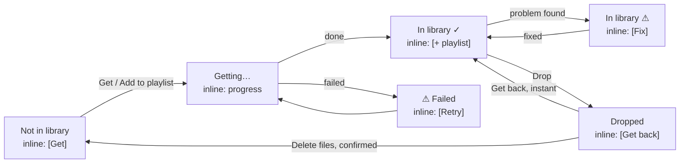
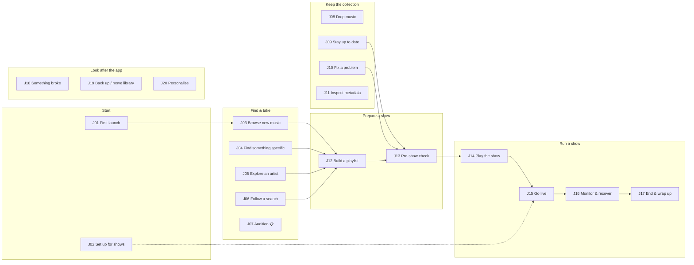
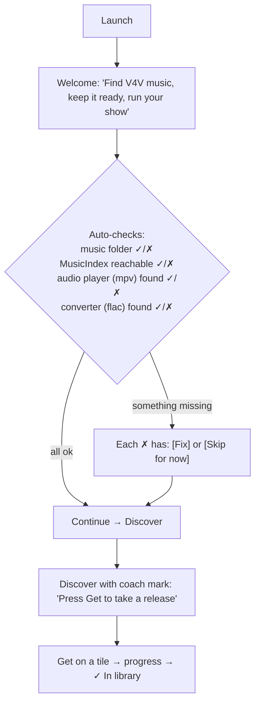
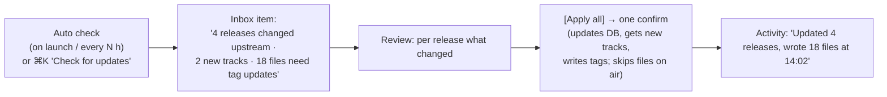
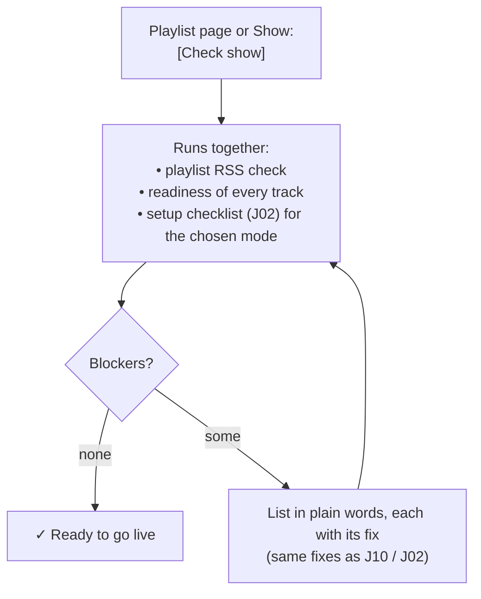
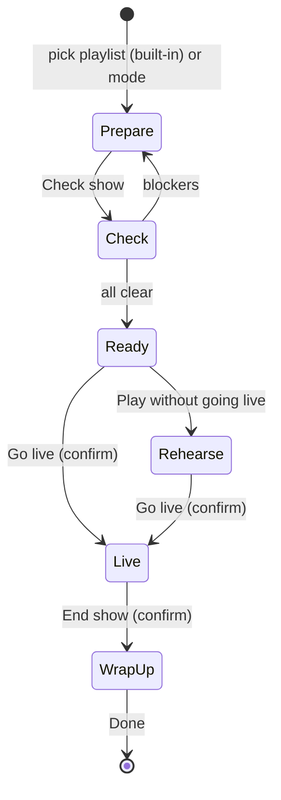

# 03 · User journeys (proposed)

Built from the user's jobs and the capabilities in [01](01-capabilities.md), **not** from today's
screens. Today's step counts come from [02](02-as-is.md). Wireframes for these journeys come next,
in `04-wireframes.md`, once this list is agreed.

---

## 1. Who uses it

| Persona | Who | What they want from v4vmm |
|---|---|---|
| **Curator** | A V4V music podcaster (exemplar from the project brief: a Linux user who already uses Mixxx and butt) | Find music, keep a trusted collection, build show playlists |
| **Host, built-in player** | Same person, running a show from v4vmm's own player | Play the playlist, go live, stay calm, end cleanly |
| **Host, Mixxx** | Same person, DJing in Mixxx | Glance at v4vmm to confirm everything's healthy |
| **Recorder** *(planned)* | Same person, pre-recording a show privately | Capture song timings for later packaging, no public publishing |
| **Newcomer** | Anyone opening the app for the first time | Understand what it is and get a first track in |

It's one human wearing different hats, so journeys hand off to each other: collect → prepare → run.

---

## 2. Design principles (derived from the friction in 02)

These are what actually reduce steps and make the app learnable. Every journey below applies them.

| # | Principle | Fixes friction |
|---|---|---|
| **P1** | **Same item, same powers, everywhere.** A release or track row offers the same inline action and the same menu whether it appears in Discover, search, an artist page, a playlist or the Library. Origin never matters. | Dead ends, origin-dependent actions |
| **P2** | **Three verbs: Get · Add to playlist · Drop.** (Plus **Play** once audition lands.) One word each, everywhere. Adding to a playlist *includes* Get and shows in the same progress. | 5 Remove labels, 4 Download labels |
| **P3** | **Four visible states:** *Not in library* · *Getting…* · *In library* (✓ or ⚠ needs attention) · *Dropped* (file still on disk). | ~10 code states scattered across screens |
| **P4** | **One inbox for "needs a decision", one activity log for "what happened".** Feedback shows where the user is (inline or a toast), never in another section. | 5 problem places, invisible status lines |
| **P5** | **A show is a guided sequence:** Prepare → Check → Live → Wrap up. One primary button per stage. On-air actions ask for confirmation. | Shapeless dashboard, no end |
| **P6** | **Setup is forms with a Test button, never raw config.** First run is a short, skippable checklist. | TOML fields, silent default player |
| **P7** | **Everything is findable from one command palette** (⌘K / Ctrl+K) that lists every action with its shortcut. Empty states say what to do next. | No menu bar on Linux, hidden shortcuts |
| **P8** | **Automation reports back.** Background checks still run on their own, but what they find becomes one inbox item with a summary. | Hidden automation |

### The item model (P1–P3 in one picture)

Every row shows **one** inline action for its state (in brackets above). The row menu always has the
same items: *Get · Add to playlist › · Play (later) · Go to artist · Go to release · Sources · Drop*.
Items that don't apply are absent, never disabled-and-unexplained.

---

## 3. The journey map

### Catalogue

| ID | Journey | Persona | How often | Steps today | Target | Needs new backend? |
|---|---|---|---|---|---|---|
| J01 | First launch → first track, with real audio | Newcomer | once | 2 + impossible audio | **3** | small: detect mpv |
| J02 | Set up for shows (pick mode, connect services) | Host | once | raw TOML, ~6+ per item | **form per item + Test** | no (forms over existing config) |
| J03 | Browse what's new and take it | Curator | daily | 2 | **1** | no |
| J04 | Find something specific and take it | Curator | daily | 7 (3 singles) | **5** | no |
| J05 | Explore an artist, take what's missing | Curator | weekly | n+1 via selection | **2** | no |
| J06 | Follow a search ("anything new for *bluegrass*?") | Curator | weekly | 2, no "new" signal | **1** | small: remember last visit |
| J07 | Audition before taking | Curator | daily | not possible | **1** | 📋 ADR 0068 |
| J08 | Drop music (undo, free disk space) | Curator | occasional | ~8 across 2 sections | **1** (+1 to delete files) | no: undo uses a built-but-unused command |
| J09 | Keep the library up to date | Curator | weekly | 4, manual, misses new tracks | **2** | yes: add newly published tracks |
| J10 | Fix a track problem | Curator | per show | 2 / 4 / no fix | **2**, every type | small: fixes for 3 types |
| J11 | Inspect / correct a track's metadata | Curator (expert) | rare | ~4, Library only | **2** | no |
| J12 | Build a show playlist | Curator | per show | 6–9 per add path | **3 to create, 1 per add** | no |
| J13 | Pre-show check | Host | per show | 3 separate places | **1 + fixes** | no (combines existing checks) |
| J14 | Play the show (built-in player) | Host | per show | 3, no stop/cue | **1** | no: stop/seek already built |
| J15 | Go live | Host | per show | 6–10 + external RSS edit | **2** once set up | small: verify feed tag |
| J16 | Monitor & recover while live | Host (both) | per show | spread across cards | **0 to see, 1 to fix** | no |
| J17 | End the show & wrap up | Host | per show | 6, never ends | **2** | no: stop/recording already built; package 📋 |
| J18 | Something broke → recover | anyone | rare | Repair → notice → raw TOML | **1 to the right form** | no |
| J19 | Back up, restore, or move the library | anyone | rare | raw config + end session | **guided** | no |
| J20 | Personalise (theme, size) | anyone | rare | change + remember Save | **1** | no |
| X1 | *Learn the app* (cross-cutting) | everyone | always | no menu, hidden shortcuts | ⌘K palette everywhere | no |

---

## 4. The journeys

Steps describe intent, not final layout. Wireframes (04) will fix the layout.

### Start

#### J01 · First launch → first track, with real audio
**Goal:** understand what the app is, get a first release, and know whether audio works.
**Trigger:** first launch (no config file existed).

1. Welcome explains the app in one line and runs the checks automatically.
2. **Continue** (1). Anything missing shows as a plain-language row with *Fix* (a form) or *Skip*. mpv found → audio turned on automatically instead of the silent default.
3. Land on Discover. **Get** on a tile (2). Watch it arrive.
4. A checklist stays in the inbox until done: *Get a release · Make a playlist · Set up for shows (optional)*.

**Changes vs today:** onboarding exists; silent player never happens by surprise; connectivity actually tested.

#### J02 · Set up for shows
**Goal:** tell the app how you broadcast, connect each piece, and see each one go green.
**Trigger:** first visit to Show, or the checklist item.
1. Show (empty state): *"How do you run your show?"* → **Built-in player** · **Mixxx** · **Record only (later)**.
2. A per-mode checklist appears. Built-in mode, for example: *Audio player · Publisher host · Now-playing folder · Stream encoder · Live event*. Mixxx mode swaps the audio player for *Mixxx producer*.
3. Each item opens a **form** (fields with labels, a folder picker, a host picker) and has a **Test** button. ✓ when it passes.
4. The checklist is what J13's pre-show check reads, so setup and the check never disagree.

**Changes vs today:** raw TOML keys disappear; mode decides which items appear (curator brief's "production modes").

### Find & take

#### J03 · Browse what's new and take it
1. Music opens on Discover › New releases.
2. **Get** inline on a tile or row (1). Or select several → **Get n** (n+1).
3. Clicking the tile itself opens the release page, which has the same Get.

**Today 2 → 1.** Discover rows also gain the standard row menu (today they have none).

#### J04 · Find something specific
1. ⌘F, type, Enter (3). Results: Releases · Artists · Tracks. Every row has its inline action (P1).
2. **Get** on the singles you want (1 each) → 3 singles = **6**, or **Get all** on the artist result row (→ **4**).
3. A track result can be **added to a playlist** directly, which also gets it (today: impossible from a track page).

**Today 7 → 4–6, and the 9-step "Index track to playlist" path → 5** (⌘F, type, Enter, row menu, playlist).

#### J05 · Explore an artist, take what's missing
1. Open the artist from any name link or search (1).
2. Header shows *"12 releases · 7 in library"* and **Get 5 missing** (1).
3. Sections (Albums & EPs, Singles, Appears on) keep per-row Get.

**Today:** no page-level action; select each. **Target 2.**

#### J06 · Follow a search
1. Run a search → **Save search** → it appears as a view under Discover.
2. Later the view shows a count: *"bluegrass · 3 new"* (new since last visit).
3. Click (1) → new items highlighted at the top, each with Get.

**Needs:** remember "last seen" per saved search. Also: rename saved searches.

#### J07 · Audition before taking *(planned, ADR 0068)*
1. **Play** inline on any track row, Index or Library (1). A small preview bar shows progress.
2. If a show is live, audition warns: *"You're on air. Preview plays through your normal output."* → *Preview anyway*.

**Design now, build later:** the row slot is already reserved in the friend's design (ADR 0084 Decision 11).

### Keep the collection

#### J08 · Drop music
1. Row menu → **Drop** (1). A toast: *"Dropped *Album X*. Files kept. [Undo]"*.
2. Dropped items appear under a **Dropped** filter in Releases/Tracks (instead of Settings › Diagnostics › Cached files), each with **Get back** (instant, no download) or **Delete files** (confirmed, shows the size freed).
3. Bulk: select → Drop n → one confirm (n > 1).

**Today ~8 steps across two sections, no confirm on delete → 1 (+1).** Undo uses `SetTrackLibraryMembership`, which exists with no caller.

#### J09 · Keep the library up to date

1. The check runs on its own (or from ⌘K). Results arrive as **one** inbox item.
2. **Review** (1) → **Apply all** (2) → confirm. Three separate operations today (apply, scan, write tags) become one.

**Needs:** today's "apply updates" never adds newly published tracks; a library that stays current needs that.

#### J10 · Fix a track problem
1. The inbox (and the ⚠ badge on rows) lists problems **grouped by type**, in plain words: *"3 tracks can't send payments (route tag missing)"*.
2. Every type has a fix (1–2 steps), or says plainly why it can't be fixed here:

| Problem | Fix |
|---|---|
| Route tag missing | **Fix** (per track) / **Fix all** (exists, CLI only today) |
| Route out of date | **Update tag** (same as J09 write) |
| Removed from its feed | **Keep anyway** / **Drop** / **Remove from playlists** |
| File missing | **Get again** |
| Not downloaded | **Get** |
| No routes upstream | Explain: *"The artist's feed has no payment info. Listeners can't send value for this track."* + **Open feed** |

**Today:** 4 of 6 types have no action, and the row itself can't be clicked.

#### J11 · Inspect / correct a track's metadata (expert)
1. Track page › **Sources** tab (1): RSS · file tags · MusicBrainz, side by side, differences highlighted.
2. Pick values → **Write tags** (2).
3. MusicBrainz lookup is a button inside this tab, scoped and labelled (*"Look up this track"* / on a release: *"Look up all 11 tracks"*).

**Changes:** a tab rather than a hidden disclosure; works for any downloaded track.

### Prepare a show

#### J12 · Build a show playlist
1. ⌘N → type name → **Enter** (3). Today Enter does nothing.
2. The new playlist becomes the **show playlist** (pinned, shown in the sidebar). Every row everywhere gains a one-click **+ Add to *Episode 42*** (1 per add). Other playlists are still in the row menu.
3. Drag also works (today's drag, plus spring-loading, is kept).
4. Reorder by drag or ⌥↑/⌥↓. Adding a track you don't have also gets it, visible in progress.

**Today 6–9 per add path → 1.**

#### J13 · Pre-show check

1. **Check show** (1). Today this is three places: "Check RSS" on the playlist page, Needs attention, and the Show cards.
2. Fix any blockers in place. When it says ready, J15's "Go live" button becomes available.

### Run a show

#### Show stages (applies to J14–J17)

The Show section always shows **which stage you're in** and **one primary button** for the next one.

#### J14 · Play the show (built-in player)
1. From the playlist page: **Play** (1), from the top or the selected row. Or Show › Prepare → pick playlist → Play.
2. The cuelist is **interactive**: play from here, drag to reorder, remove, *Play next* (ADR 0068's cue).
3. Transport: previous · play/pause · next · **stop** · elapsed/seek (stop and seek are built, just not wired).
4. The last track ending means the show's music has finished, not an error.

**Today:** play only from a hovered row; no stop; the cuelist is read-only; end of playlist is an error.

#### J15 · Go live
1. From Ready: **Go live** (1) → confirm sheet listing what will happen: *"Use event Episode 42 · attach to publisher · start producer · connect stream to <server>. You will be on air."* → **Go live** (2).
2. The app runs the steps in order with a live checklist, stopping at the first failure with its fix.
3. The first time only: the feed tag step shows the exact `<podcast:liveValue>` line with **Copy**, then **verifies** your show's RSS feed contains it (today: silent copy, and a known bug writes a bare id instead of the URL).
4. Events: reuse the selected one, or **New event** at any time. Old events can be **forgotten** (today: CLI only).

**Today 6–10 independent clicks, no confirmation → 2.**

#### J16 · Monitor & recover while live
1. The Live view shows, without any clicks: what listeners see now (art, artist, title, value split), one health row per service, listeners, recording timer, recent songs, and next up (built-in mode).
2. A failure turns its row red **in place**, with one fix (*Restart publisher*, *Reconnect stream*) and *Logs*.
3. In Mixxx mode this view *is* the screen: no cuelist, larger health and now-playing.

#### J17 · End the show & wrap up
1. **End show** (1) → confirm: *"Disconnect stream · stop playback · stop recording · keep publisher running? [ ]"* → **End** (2).
2. Wrap-up summary: duration, tracks played (with times), recording file path, issues that happened.
3. *(Planned)* **Package episode**: recording, song timings, value-time splits, RSS episode draft.

**Today 6 clicks and the session never ends (CLI needed) → 2.** Stop and recording are already built.

### Look after the app

#### J18 · Something broke → recover
1. The problem appears **where it matters**: the Show row turns red, a row action fails with an inline message, and one inbox entry is created. Never only in Settings.
2. Plain words + **Fix** opens the exact form field from J02 (not a TOML key) + **Test**.
3. **More info** shows logs and the copyable report (keep today's good diagnostics, just reachable).

#### J19 · Back up, restore, or move the library
Settings › Library: **Back up now** · **Restore…** (keep today's review-then-restore safety) · **Move music folder…** (folder picker → app explains it will restart the session → done). Today, moving needs the raw editor plus "End app session".

#### J20 · Personalise
Theme and size apply **and save** instantly. No separate Save, no lost changes on relaunch.

#### X1 · Learn the app (cross-cutting)
- **⌘K command palette:** every action in the app, searchable, with its shortcut, scoped to what's selected. This also gives Linux, which has no menu bar, a full action list.
- **Empty states teach:** *"No playlists yet. ⌘N to make one, or + Add from any track."*
- **Consistent row menus** (P1) mean learning one row teaches all of them.
- The first-run checklist (J01) introduces the core loop.

---

## 5. What needs new code below the UI

Most journeys are UI-only re-wiring of existing capabilities. Real backend work:

| Need | For | Size |
|---|---|---|
| Detect mpv / flac on first run and pick the driver | J01 | small (probes exist) |
| Remember "last seen" per saved search; rename | J06 | small |
| Apply updates also adds newly published tracks | J09 | medium |
| Scheduled/background feed check | J09 | small |
| Fixes for *file missing* / *route out of date* / *removed from feed* | J10 | small (reuse get / tag write) |
| Combined "check show" query | J13 | small (composition) |
| Verify the show's own RSS contains the liveValue tag (needs the show's feed URL) | J15 | small–medium |
| Orchestrated "go live" / "end show" sequences | J15, J17 | medium |
| Unified inbox + activity log (where results land) | P4 | medium |
| Audition, cue | J07, J14 | 📋 ADR 0068 |
| Episode packaging | J17 | 📋 upstream |

**Already built, just unwired:** stop, seek, play single track, recording start/stop, forget event,
fix all routes, undo drop (`SetTrackLibraryMembership`).

---

## 6. Where this departs from the project's current decisions

The friend's repo binds design through ADRs. We're re-discovering, so these proposals would need
to go to them as amendments:

| Proposal | Touches |
|---|---|
| Inline Get on every row; standard row menu everywhere | ADR 0083 Decisions 5–6, ADR 0084 Decision 10 (compatible: selection mode stays) |
| Inbox replaces "Needs attention" destination + sidebar footer buttons + capability notice | ADR 0084 Decision 2, ADR 0083 Decision 7, ADR 0066 |
| "Dropped" in Music replaces Settings › Cached files | ADR 0074, ADR 0060 |
| "Show playlist" pinned for one-click add | ADR 0060 ("curation shows nothing operational": a pinned playlist isn't operational, but worth checking) |
| Show as stages instead of card dashboard | ADR 0059, ADR 0063 |
| Forms for broadcast setup | ADR 0069 (already plans "live metadata setup", task 003) |
| Command palette | new ADR |

Aligned already: ADR 0084's "the Library is a state, not a place", one page per item, selection mode.

---

## 7. Questions for you before wireframes

1. **Production modes:** design all three (built-in, Mixxx, record-only) now, or built-in + Mixxx and leave record-only as a placeholder?
2. **Dropped:** OK to move cached files out of Settings into Music as a "Dropped" state?
3. **Updates:** automatic feed checks (on launch / interval) with an inbox item, or keep them manual?
4. **Show playlist:** like the pinned one-click "+ Add to *Episode 42*" idea?
5. **Constraints:** treat the friend's ADRs as hard constraints, or propose amendments freely (as section 6 does)?
6. **Audition:** wireframe the slot now (assuming ADR 0068 lands), or leave it out?
7. **Anything missing?** A job the curator does that isn't in J01–J20?
