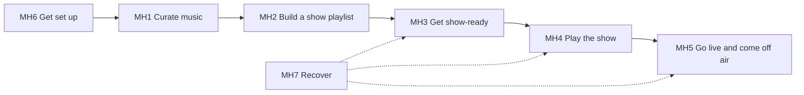

# 03a · Must-have journeys

The smallest set of journeys the app must have to do its job. Everything else waits.
We act with freedom here: the friend's existing design decisions are not constraints.
Capability IDs refer to [01a](01a-capabilities-summary.md). The long list of 20 is in [03](03-journeys.md).

## What the app is for

> A V4V music podcaster **finds music**, **keeps it ready**, and **runs a show** with it.

A journey is **must-have** if, without it, that loop breaks, or the show loses listeners' trust
or money (V4V payments ride on correct route tags).

## Principles every journey follows

Each journey below cites these as **(P#)**. They come from the problems found in today's app
([02 · Cross-cutting friction](02-as-is.md#cross-cutting-friction-the-real-problems), items F1–F9) and are
explained in full in [03 · Design principles](03-journeys.md#2-design-principles-derived-from-the-friction-in-02).

| ID | Principle | Fixes |
|---|---|---|
| **P1** | Same item, same actions, everywhere: a row's inline action and menu don't depend on where you found it | F1 different powers by origin |
| **P2** | Three verbs only: **Get · Add to playlist · Drop**. Adding to a playlist includes Get | F2 one verb, many words |
| **P3** | Four visible states: *Not in library · Getting · In library (✓/⚠) · Dropped* | F1, F4 |
| **P4** | Results show where the user is (inline or toast). Problems go to **one inbox** | F3 feedback elsewhere, F4 problems in 5 places |
| **P5** | A show is a sequence: Prepare → Check → Live → Wrap up. Going on air, ending a show and deleting files always ask first. Nothing else does | F5 Show has no shape |
| **P6** | Setup is forms with a Test button, never raw config | F6 raw config setup |
| **P7** | **⌘K** lists every action with its shortcut. Empty states say what to do next | F8 low discoverability |
| **P8** | Background checks report what they found into the inbox | F7 hidden automation |

F9 (built features with no button) isn't a principle. Those features are simply used in MH4 and MH5.

## The set: 7 journeys

| ID | Journey | Done when | Target steps | Today | Combines ([long list](03-journeys.md#catalogue)) | Wireframes |
|---|---|---|---|---|---|---|
| **MH1** | **Curate music:** find, take, drop | A release is in the library (or out of it) | **1** from any row | 2–9 | [J03](03-journeys.md#j03--browse-whats-new-and-take-it "Browse what's new and take it") [J04](03-journeys.md#j04--find-something-specific "Find something specific") [J05](03-journeys.md#j05--explore-an-artist-take-whats-missing "Explore an artist, take what's missing") [J08](03-journeys.md#j08--drop-music "Drop music") | [MH1-curate](wireframes/MH1-curate.md) |
| **MH2** | **Build a show playlist** | Playlist exists, ordered, every track gettable | **3** to create, **1** per add | 6–9 per add | [J12](03-journeys.md#j12--build-a-show-playlist "Build a show playlist") | [MH2-playlist](wireframes/MH2-playlist.md) |
| **MH3** | **Get show-ready:** updates, problems, pre-show check | "Ready" with zero blockers | **1** check + **1** per fix | 3 places, 4 of 6 problems unfixable | [J09](03-journeys.md#j09--keep-the-library-up-to-date "Keep the library up to date") [J10](03-journeys.md#j10--fix-a-track-problem "Fix a track problem") [J13](03-journeys.md#j13--pre-show-check "Pre-show check") | [MH3-show-ready](wireframes/MH3-show-ready.md) |
| **MH4** | **Play the show** (built-in player) | Music plays in order, can be steered, ends cleanly | **1** to start | 3, no stop, ends in error | [J14](03-journeys.md#j14--play-the-show-built-in-player "Play the show (built-in player)") | [MH4-play](wireframes/MH4-play.md) |
| **MH5** | **Go live and come off air** | Listeners hear it with correct metadata; then cleanly off | **2** on, **2** off | 6–10 on, 6 off (never ends) | [J15](03-journeys.md#j15--go-live "Go live") [J16](03-journeys.md#j16--monitor--recover-while-live "Monitor & recover while live") [J17](03-journeys.md#j17--end-the-show--wrap-up "End the show & wrap up") | [MH5-live](wireframes/MH5-live.md) |
| **MH6** | **Get set up:** first run + show setup | Audio works, services green | **1** per item (form + Test) | raw config, silent player | [J01](03-journeys.md#j01--first-launch--first-track-with-real-audio "First launch → first track, with real audio") [J02](03-journeys.md#j02--set-up-for-shows "Set up for shows") | [MH6-setup](wireframes/MH6-setup.md) |
| **MH7** | **Recover when something breaks** | Problem fixed without hunting through Settings | **1** to the right fix | Repair → notice → raw config | [J18](03-journeys.md#j18--something-broke--recover "Something broke → recover") | [MH7-recover](wireframes/MH7-recover.md) |

### Why each one is a must
- **MH1:** nothing else exists without music in the library. Taking and dropping are one item model.
- **MH2:** a show is a playlist (built-in mode) or at least a plan for one.
- **MH3:** broken route tags mean lost payments, and a stale feed means wrong metadata on air. This is what makes v4vmm worth using over a plain player.
- **MH4:** built-in playback is one of the two ways to run a show.
- **MH5:** going live is the end goal. Today it's the riskiest flow, with no confirmation and no end.
- **MH6:** today a new user can't hear audio without editing raw config.
- **MH7:** a live show can't afford a hunt through Settings when something fails.

## Each journey, optimal path

### MH1 · Curate music
- **Wireframes:** [MH1-curate.md](wireframes/MH1-curate.md)
- **Entry:** Discover (default), search ⌘F, any artist or release name link.
- **Path:** see a row → **Get** (inline, 1). Many: select → **Get n**. Artist page header → **Get n missing** (1). Reverse: row menu → **Drop** (1) → toast with **Undo**.
- **Rule (P1, P2, P3):** every release or track row has the same inline action and menu, wherever it appears.
- **Uses:** D1 D2 D4 D6 · C1 C2 C3 C4 · L1 L3 L4

### MH2 · Build a show playlist
- **Wireframes:** [MH2-playlist.md](wireframes/MH2-playlist.md)
- **Entry:** ⌘N, or "New playlist" in any Add menu.
- **Path:** ⌘N → name → Enter (3). It becomes the **show playlist**: every row gets **+ Add to *Episode 42*** (1). Drag to reorder.
- **Rule (P2, P4):** adding a track you don't have also gets it, visible in the same progress.
- **Uses:** P1 P2 P3 P4 · C1 C2 C4

### MH3 · Get show-ready
- **Wireframes:** [MH3-show-ready.md](wireframes/MH3-show-ready.md)
- **Entry:** inbox badge, the playlist's **Check show** button, Show stage "Check".
- **Path:** **Check show** (1): RSS check + readiness + updates + setup, in one pass. Blockers listed in plain words, each with its fix (1). Library-wide updates arrive as one inbox item → **Apply all** (1 + confirm).
- **Rule (P4, P8):** every problem type has a fix or a plain explanation. Background checks report into the inbox.
- **Uses:** M1 M2 M4 M5 · R1 R2 R3 R4 R5 · C2
- **New backend:** apply updates adds newly published tracks; fixes for "file missing" and "route out of date".

### MH4 · Play the show
- **Wireframes:** [MH4-play.md](wireframes/MH4-play.md)
- **Entry:** playlist page **Play**, or Show › Prepare.
- **Path:** **Play** (1), from the top or the selected row. Cuelist: play from here, reorder, remove. Transport: prev · play/pause · next · **stop**.
- **Rule (P5):** the last track ending is a normal finish, not an error.
- **Uses:** B1 B2 B3 B4 B6 (B7 cue when ready)

### MH5 · Go live and come off air
- **Wireframes:** [MH5-live.md](wireframes/MH5-live.md)
- **Entry:** Show, once MH3 says Ready.
- **Rule (P5, P4):** one primary button per stage; on-air and end-show ask first; failures show in place.
- **Path on:** **Go live** (1) → confirm sheet ("you will be on air", lists the steps) (2). The app runs event → attach → producer → stream in order, stopping at the first failure with its fix. First time only: copy the feed tag, and the app checks that your RSS feed contains it.
- **While live:** listener view, one health row per service, listeners, recording; failures turn red in place with one fix.
- **Path off:** **End show** (1) → confirm (2): stream off, playback stopped, recording stopped, summary shown.
- **Uses:** V1 V2 V4 V5 V6 V7 V8 V9 V10 V11 · B4
- **New backend:** orchestrated on/off sequences; feed-tag check; fix the feed-tag bug.

### MH6 · Get set up
- **Wireframes:** [MH6-setup.md](wireframes/MH6-setup.md)
- **Entry:** first launch; first visit to Show.
- **Path:** Welcome runs the checks itself (music folder, MusicIndex reachable, mpv, flac) → **Continue** (1). In Show: pick the mode (built-in / Mixxx) → checklist of items, each a **form + Test** (1 per item).
- **Rule (P6):** no raw config keys. MH3's check reads the same checklist.
- **Uses:** S1 S3 S5 S6 · B6
- **New backend:** detect mpv/flac and turn on the real player; connection test for MusicIndex.

### MH7 · Recover when something breaks
- **Wireframes:** [MH7-recover.md](wireframes/MH7-recover.md)
- **Entry:** wherever the failure shows (a Show row, a row action, the inbox). Never only in Settings.
- **Rule (P4, P6):** the problem shows where you are; the fix is a form, never raw config.
- **Path:** plain-language message → **Fix** opens the exact MH6 form field (1) → Test. **More info** shows logs and a copyable report.
- **Uses:** S7 S9 · V6 · C5

## Not must-have (and why)
| Later | Reason |
|---|---|
| Follow a search (D7+) · inspect / correct metadata (M6 M7) · back up / move library (S4 S8) · personalise (S2) · browse A–Z (D3) | Nice to have, and the loop works without them |
| Audition (D8) · cue (B7) · record-only mode · package episode (V14) · talk breaks (V13) · curator playlists (D9) | Need backend work that's only planned |
| Paste RSS URL (C6) · import own files (C7) | New acquisition paths, not needed for the V4V loop |

## Order to work through them

Design order isn't the order users meet things: each step reuses patterns from the one before.

| # | Design | Because it defines |
|---|---|---|
| 1 | **MH1** Curate music | The item, its states, the row and its actions. Everything else reuses them |
| 2 | **MH2** Build a show playlist | Playlists and the show playlist, built on MH1 rows |
| 3 | **MH3** Get show-ready | The inbox and the problem/fix pattern |
| 4 | **MH4** Play the show | The Show stages and the player |
| 5 | **MH5** Go live and come off air | The live sequence, built on MH3 checks and MH4 stages |
| 6 | **MH6** Get set up | Onboarding and setup forms, once we know every item MH4–MH5 need |
| 7 | **MH7** Recover | Reuses the inbox (MH3) and the forms (MH6) |

**Wireframes:** all seven are in [wireframes/](wireframes/README.md), built on shared [foundations](wireframes/00-foundations.md) and [components](wireframes/01-components.md).
