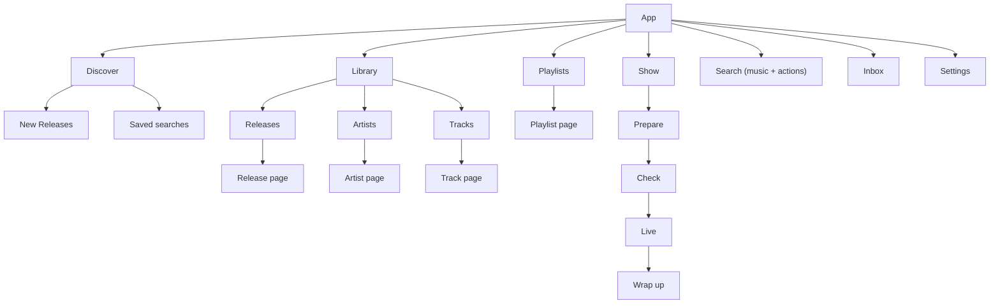

# 00 · Foundations

The structure every wireframe follows. Wireframes contain **no visual style**, only roles: type
roles, spacing steps, colour roles and component names. A theme maps each role to a real value, so
the app can be restyled (see [visual-ideas-later.md](visual-ideas-later.md)) without moving anything.

Built against Apple's Human Interface Guidelines: layout, typography, navigation, sidebars, tab bars,
toolbars, sheets, alerts, menus, accessibility. The checklist at the end (§10) is what each screen is
checked against.

---

## 1. Platforms and assumptions

| Platform | Role | Notes |
|---|---|---|
| **Desktop** (Linux first, macOS) | Full app | Talks to local services (mpv, butt, systemd, flac) |
| **Web** | Same structure as desktop / phone by width | Every page has a URL (§3) |
| **Phone / tablet** | Companion | Curate, build playlists, monitor a live show. Host-only controls (start a local service) show **Requires desktop** instead of a broken button |

One structure across all three; only the **shell** adapts (§4).

---

## 2. Information architecture



- **Library is a state, not a place.** A release page is the same page whether you own it or not.
  The Library section just lists what you own (plus a *Dropped* filter).
- **Search finds music *and* actions.** Typing "new pl" offers *New Playlist ⌘N*. That's the command palette (P7).
- **Inbox** collects everything that needs a decision (P4). **Activity** (downloads, background
  checks) is a toolbar popover, not a page.

---

## 3. Routes (web URLs, also used for deep links and window restore)

| Route | Page |
|---|---|
| `/discover` · `/discover/saved/:id` | Discover, saved search |
| `/search?q=` | Search results |
| `/library/releases?filter=all\|attention\|dropped` · `/library/artists` · `/library/tracks` | Library lists |
| `/release/:feedGuid` · `/track/:feedGuid/:itemGuid` · `/artist/:feedGuid` · `/artist/name/:key` | Item pages |
| `/playlists/:id` | Playlist |
| `/show` (stage is state, not a route) | Show |
| `/inbox` | Inbox |
| `/settings/:section` | Settings |

---

## 4. The shell in three widths

Size classes match Apple's compact / regular split. Web breakpoints are given in CSS px.

| Class | Width | Shell |
|---|---|---|
| **Compact** | < 600 px (phones) | Tab bar · navigation stack · sheets |
| **Medium** | 600–999 px (tablet, narrow window) | Collapsible sidebar (overlay) · content |
| **Expanded** | ≥ 1000 px (desktop) | Sidebar · content · optional inspector |

### 4.1 Expanded (desktop, wide web)

```
┌──────────────────────────────────────────────────────────────────────────────────────────────┐
│ ●●●  ◧  ‹ ›   Page Title                       [⌕ Search music and actions   ⌘K]  [⤓]  [◨]   │ Toolbar
├───────────────────┬──────────────────────────────────────────────────────────┬───────────────┤
│ Discover          │                                                          │ Inspector     │
│   New Releases    │                                                          │ (toggle ◨)    │
│   Saved searches… │                 CONTENT                                  │               │
│ Library           │                 (navigation stack:                       │ Up Next ·     │
│   Releases        │                  ‹ goes back, title in toolbar)          │ Sources ·     │
│   Artists         │                                                          │ Details       │
│   Tracks          │                                                          │               │
│ Playlists         │                                                          │               │
│   ★ Episode 42    │                                                          │               │
│   Winter Mix      │                                                          │               │
│   + New Playlist  │                                                          │               │
│ Show              │                                                          │               │
│ ───────────────── │                                                          │               │
│ Inbox          3  │                                                          │               │
│ Settings          │                                                          │               │
├───────────────────┴──────────────────────────────────────────────────────────┴───────────────┤
│ Show accessory · only while a show is active    ▶ Artist — Title    ● LIVE 00:42:10   [Open] │
└──────────────────────────────────────────────────────────────────────────────────────────────┘
```
- **Toolbar:** sidebar toggle `◧`, back/forward `‹ ›`, page title (Headline), search field (trailing, ⌘K / ⌘F),
  Activity `⤓` (shows a progress ring only while work runs), inspector toggle `◨`.
- **Sidebar:** source list with section headers. Width 220–280 pt, user-resizable.
- **Inspector:** optional trailing panel, 280–340 pt. Holds secondary detail so pages don't need a
  third column.
- **Show accessory:** a bottom bar shown **only** while a show is playing or live (HIG: status
  appears when relevant).
- macOS: Settings opens from the app menu (⌘,) in its own window. Linux/web: the "Settings" sidebar item.

### 4.2 Medium (tablet, narrow window)

```
┌────────────────────────────────────────────────────────────┐
│ ◧  ‹   Page Title                    [⌕]   [⤓]  Inbox 3    │
├────────────────────────────────────────────────────────────┤
│                                                            │
│                       CONTENT                              │
│      (sidebar slides over from ◧; inspector → sheet)       │
│                                                            │
├────────────────────────────────────────────────────────────┤
│ ▶ Artist — Title                 ● LIVE 00:42:10   [Open]  │
└────────────────────────────────────────────────────────────┘
```

### 4.3 Compact (phone)

```
┌────────────────────────────────────┐
│ 9:41                        ▮▮▮ ◔  │ status bar (safe area)
│ ‹ Back            Inbox 3     ⋯    │ nav bar
│ Page Title                         │ Large Title (collapses on scroll)
│                                    │
│             CONTENT                │
│                                    │
├────────────────────────────────────┤
│ ▶ Artist — Title     ● LIVE  ›     │ accessory: show status, else downloads
├────────────────────────────────────┤
│ Discover  Library  Show  Search    │ tab bar (4 tabs, icon + label)
└────────────────────────────────────┘
```
- **Tabs:** Discover · Library (holds Releases, Artists, Tracks, **Playlists**) · Show · Search.
  Four tabs, within HIG's 3–5.
- **Inbox** is a nav-bar button on every tab root. `⋯` holds Settings and Activity.
- The accessory above the tab bar shows show status, otherwise download progress, otherwise nothing.

---

## 5. Typography

Only these roles exist. Sizes are Apple's defaults at the standard text size. Every size scales
with the user's text-size setting (Dynamic Type; browser font size on web).

| Code | Role | Token | iOS pt | macOS pt | Web rem | Weight | Used for |
|---|---|---|---|---|---|---|---|
| **LT** | Large Title | `type.largeTitle` | 34 | 26 | 2.125 | Bold | Page title, one per page (compact: in nav bar) |
| **T1** | Title 1 | `type.title1` | 28 | 22 | 1.75 | Bold | Item name on a release, artist or playlist header |
| **T2** | Title 2 | `type.title2` | 22 | 17 | 1.375 | Bold | Section headers ("Albums & EPs", "Up Next") |
| **T3** | Title 3 | `type.title3` | 20 | 15 | 1.25 | Semibold | Sheet and card titles, stage names |
| **HL** | Headline | `type.headline` | 17 | 13 | 1.0625 | Semibold | Toolbar title, emphasised row text, button labels |
| **BD** | Body | `type.body` | 17 | 13 | 1.0625 | Regular | Row titles, paragraphs, form values |
| **CO** | Callout | `type.callout` | 16 | 12 | 1 | Regular | Inbox and checklist explanations |
| **SH** | Subheadline | `type.subheadline` | 15 | 11 | 0.9375 | Regular | Row second line (artist · kind · year), sidebar section headers (semibold) |
| **FN** | Footnote | `type.footnote` | 13 | 10 | 0.8125 | Regular | Help under fields, timestamps, counts |
| **C1** | Caption 1 | `type.caption1` | 12 | 10 | 0.75 | Medium | Badges, tile second line, durations |
| **C2** | Caption 2 | `type.caption2` | 11 | 10 | 0.6875 | Medium | Tab bar labels, smallest allowed text |

**Rules**
1. One **LT** per page. **T1** only in item headers. Hierarchy always descends: LT → T1 → T2 → T3 → HL/BD.
2. Nothing smaller than **C2**.
3. Durations, timers, counts and positions use **tabular figures** so columns don't jitter.
4. **Title Case** for buttons, menu items, tabs, sidebar items and sheet titles. **Sentence case** for
   descriptions, help text, inbox and alert bodies.
5. Long text **wraps**; it is never cut off when it's essential (titles, warnings). Single-line rows
   may cut off the *secondary* line with an ellipsis, and the full text appears on hover and to VoiceOver.
6. A theme may swap the font family per role (for example a display face for LT/T1). Sizes and roles stay.

Wireframes mark roles in the right margin (`LT`, `BD`, …).

---

## 6. Layout, spacing, targets

| Token | Value (pt) | Use |
|---|---|---|
| `space.1` … `space.8` | 4 · 8 · 12 · 16 · 20 · 24 · 32 · 40 | 4-pt base, 8-pt rhythm |
| `margin.compact` / `margin.regular` | 16 / 20 (phone) · 20 / 24 (desktop) | Layout margins |
| `row.compact` / `row.regular` | 56 (touch) / 44 (pointer) | List rows with artwork |
| `target.touch` / `target.pointer` | 44 × 44 / 28 tall | Minimum hit areas |
| `art.row` | 44 (touch) / 36 (pointer) | Row artwork |
| `art.tile` | min 150, grid fills width | Tiles |
| `art.header` | 220 (desktop) / 60% width (phone) | Item header artwork |
| `sidebar.width` / `inspector.width` | 220–280 / 280–340 | Columns |

- Everything aligns to the **leading edge** of the content column: titles, artwork and text start at one line.
- Content inside **safe areas** (phone notch, home indicator, macOS title bar).
- No horizontal scrolling of the page. Shelves (horizontal rows of tiles) scroll within themselves,
  and have a *See All* button.

---

## 7. Theme tokens (names only)

| Group | Tokens |
|---|---|
| Surfaces | `bg.window` `bg.sidebar` `bg.content` `bg.elevated` (sheets, popovers) `bg.selected` `bg.hover` |
| Text | `fg.primary` `fg.secondary` `fg.tertiary` `fg.onAccent` `fg.link` |
| Accent | `accent` `accent.subtle` `focus.ring` |
| Lines | `separator` `border.control` |
| State | `state.ok` `state.warn` `state.danger` `state.info` `state.live` (reserved for on-air only) |
| Entity | `entity.release` `entity.track` `entity.artist` `entity.playlist` (identity hues, **never** used for status) |
| Material | `material.sidebar` `material.toolbar` `material.sheet` (blur/vibrancy, or flat when Reduce Transparency is on) |
| Shape | `radius.control` `radius.row` `radius.art.sm` `radius.art.lg` `radius.pill` (= height ÷ 2) |
| Depth | `shadow.art` (artwork only, scales with size). Chrome uses separators, not shadows |
| Motion | `motion.quick` `motion.standard`. Off when Reduce Motion is on |

Themes required at launch: **Light**, **Dark**, **Increased Contrast** (both). The system theme is followed by default.

---

## 8. Icons

Icons are named by **role**. Each platform maps a role to its own icon set (SF Symbols on Apple,
an open set such as Lucide on Linux and web). Wireframes use single-character stand-ins.

| Stand-in | Role | SF Symbol |
|---|---|---|
| `⌕` | search | `magnifyingglass` |
| `⤓` | get / download / activity | `arrow.down.circle` |
| `✓` | in library / passed | `checkmark.circle` |
| `⚠` | needs attention | `exclamationmark.triangle` |
| `+` | add to playlist | `plus` / `text.badge.plus` |
| `⋯` | more actions | `ellipsis.circle` |
| `▶` `❚❚` `■` `⏭` `⏮` | play · pause · stop · next · previous | `play.fill` … |
| `●` | live | `dot.radiowaves.left.and.right` |
| `★` | show playlist (pinned) | `star.fill` |
| `◍` | listeners | `person.2` |
| `↻` | retry / check again | `arrow.clockwise` |
| `≡` | reorder handle | `line.3.horizontal` |
| `◧` `◨` | sidebar / inspector toggle | `sidebar.left` / `sidebar.right` |
| `▣` | artwork placeholder | (entity monogram on `entity.*` tint) |

---

## 9. States every screen defines

| State | Pattern |
|---|---|
| **Loading** | Skeleton rows/tiles with the final layout's shape. No spinner unless the wait is over 1 s with no shape to show |
| **Empty** | Icon + one-line explanation (CO) + one primary action. Example: *"No playlists yet."* **[New Playlist]** |
| **Error** | What failed, in plain words, + **[Try Again]** + *More Info* (opens details in the inspector or a sheet) |
| **Offline** | Banner at the top of content: *"MusicIndex can't be reached. Your library still works."* Index-only actions hidden |
| **Partial** | Show what loaded; failed sections get their own inline error and Try Again |

---

## 10. HIG checklist (each screen is checked against these IDs)

**Typography (TY)**
- **TY1** Only §5 roles; no other sizes.
- **TY2** One LT per page; hierarchy descends.
- **TY3** Scales with text size; layout reflows at the largest accessibility size (rows grow, columns stack).
- **TY4** Nothing below C2; body text at BD.
- **TY5** Tabular figures for times and counts.
- **TY6** Title Case for controls, sentence case for prose.

**Layout / skeleton (LA)**
- **LA1** Margins and 8-pt rhythm from §6; content inside safe areas.
- **LA2** Works at compact, medium and expanded with no horizontal page scroll.
- **LA3** Targets ≥ 44 × 44 pt touch / ≥ 28 pt pointer.
- **LA4** Shared leading edge; artwork, titles and actions in predictable places.
- **LA5** Loading skeleton matches the final layout (no jump).

**Structure / navigation (ST)**
- **ST1** Platform navigation: sidebar (expanded/medium), tab bar (compact), back in toolbar/nav bar.
- **ST2** Every page has a title, a way back and a URL.
- **ST3** One primary action per screen; the rest in `⋯`. The context menu matches `⋯`.
- **ST4** Destructive actions use the destructive style. Undo where possible; confirm only when it can't be undone.
- **ST5** Feedback where the action happened (inline or toast), never in another section.
- **ST6** Sheets for focused tasks, with Cancel and a named confirm button. Never a sheet on a sheet.
- **ST7** Every action works from the keyboard and appears in search/⌘K with its shortcut.
- **ST8** Loading, empty, error and offline states defined (§9).

**Accessibility (AX)**
- **AX1** Every control has an accessibility label; icon-only buttons have tooltips.
- **AX2** State is never shown by colour alone (icon + word).
- **AX3** Contrast ≥ 4.5 : 1 text, ≥ 3 : 1 large text and icons, in every theme.
- **AX4** Reduce Motion and Reduce Transparency respected.
- **AX5** Focus and VoiceOver order follow the visual order.

> These checks are **design intent**. Each one still needs a person to verify it in a running prototype.
